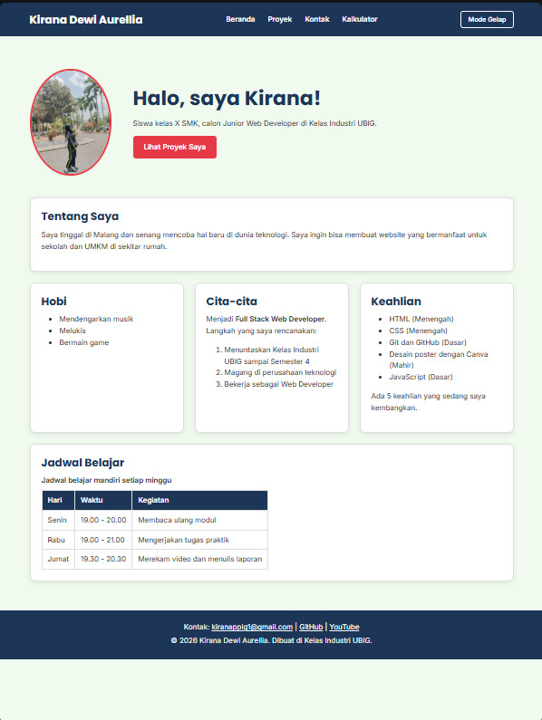

# Portofolio Kirana Dewi Aurellia

Website portofolio pribadi yang saya buat di Kelas Industri UBIG
(Paket 1, Minggu 01 sampai [09]).

Versi ini adalah **Portofolio v2**: tampil rapi di ponsel, tablet,
dan laptop, serta interaktif dengan JavaScript.

## Tampilan

## Fitur

- Halaman **Beranda** berisi profil, [hobi, cita-cita, jadwal belajar],
  dan daftar keahlian yang diambil dari `data/keahlian.json`
- Halaman **Proyek** berisi kartu proyek dari `data/proyek.json`
  dengan filter kategori ([HTML, CSS, JavaScript]), serta repositori
  GitHub terbaru dari GitHub API
- Halaman **Kontak** berisi form dengan penghitung karakter pesan
  [dan tombol tambahan jika ada]
- Halaman **Kalkulator** untuk [menghitung ...]
- Mode gelap di semua halaman
- Tampilan responsif dengan Flexbox dan *media query*

## Teknologi

- HTML5 dan CSS3 (Flexbox, *media query*, dan variabel CSS)
- JavaScript (DOM, *event*, `fetch`, dan `async`/`await`)
- JSON dan GitHub REST API
- Git, GitHub, dan [Vercel / GitHub Pages]

## Tautan

- Website: tugas-portofolio-kiranadewiaurellia.vercel.app
- Dibuat oleh: Kirana Dewi Aurellia, SMK Brantas Karangkates
